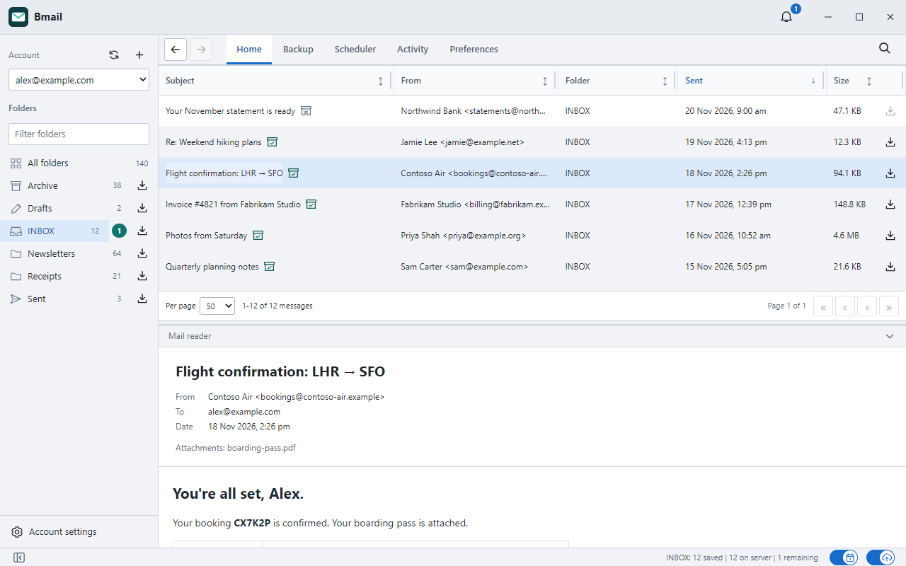
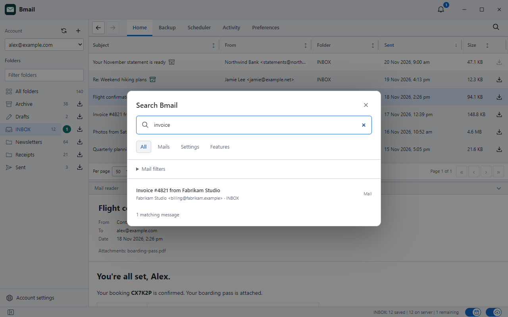
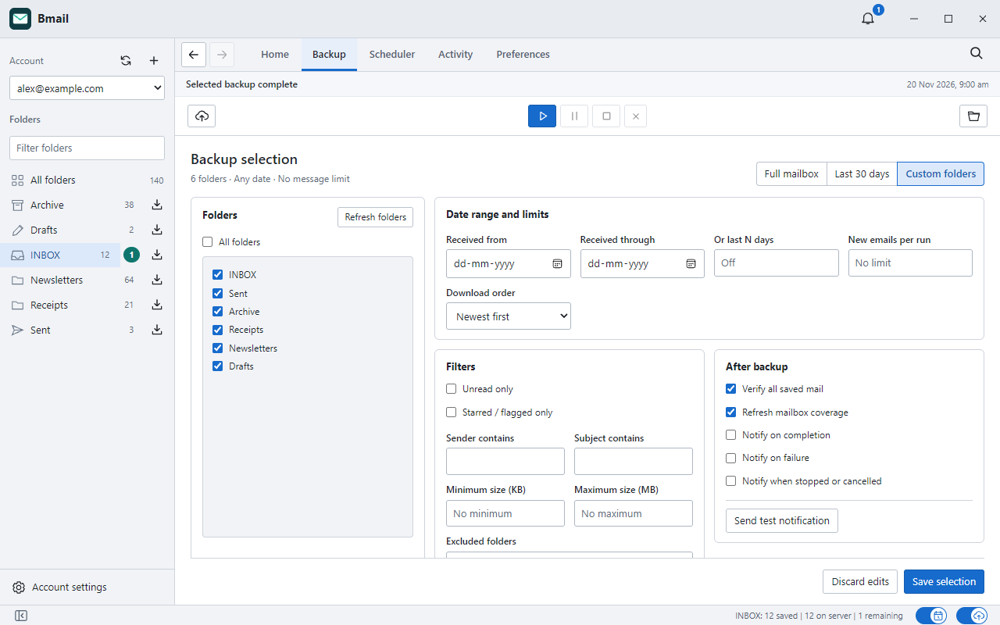
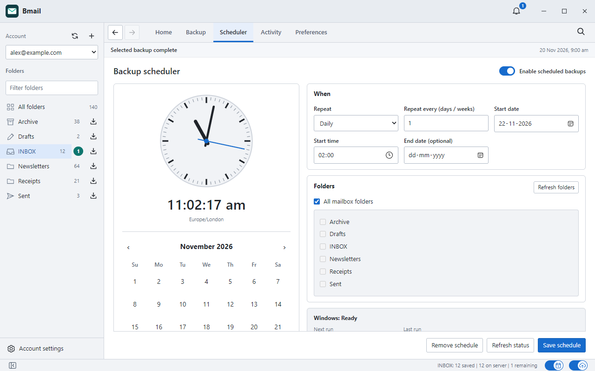
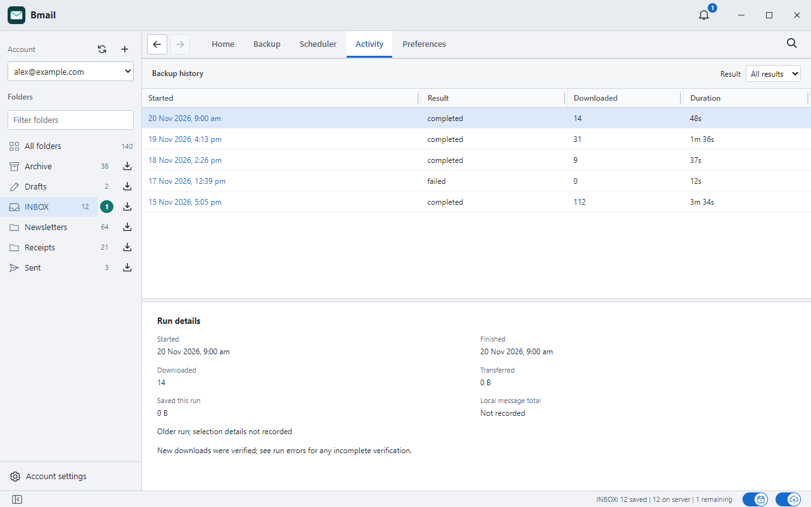

<div align="center">


# Bmail

**Local, read-only email backups for Windows.**<br>
Keep a complete copy of your Gmail, Zoho, iCloud Mail and IMAP mailboxes as standard `.eml` files on your own disk.

[](https://github.com/ayusht9/bmail/releases/latest)
[](https://github.com/ayusht9/bmail/releases)
[](LICENSE)
[](docs/WINDOWS.md)
[](https://tauri.app)
[](https://ayusht9.github.io/bmail/)

[**Download for Windows**](https://github.com/ayusht9/bmail/releases/latest) ·
[Website](https://ayusht9.github.io/bmail/) ·
[Release notes](RELEASES.md) ·
[Documentation](#documentation)

<picture>
  <source media="(prefers-color-scheme: dark)" srcset="docs/images/home-dark.png">
  
</picture>

</div>

## Features

| Feature | What it does |
|---|---|
| 🛡️ **Read-only and private** | Bmail only reads from your mail server. It never deletes, moves or flags messages. Credentials are encrypted with Windows, and no hosted service is involved. |
| 📁 **Standard `.eml` files** | Messages and attachments are saved in a portable format that other mail apps can open. Any folder can be exported as a ZIP archive. |
| 🔎 **Browse and search** | A built-in reader with sortable, resizable columns and isolated, sanitized HTML. Press <kbd>Ctrl</kbd>+<kbd>K</kbd> to search by sender, folder, date range or backup status. |
| ⏰ **Scheduled and incremental** | Back up on a Windows schedule. New-mail checks fetch only what's missing, and every backup can be paused, resumed or stopped. |
| ☁️ **Optional cloud copies** | Copy verified backups to Google Drive, Dropbox or your iCloud Drive folder. This is off until you turn it on. |
| 📊 **Coverage you can check** | Statistics compare your local copy with the full mailbox, so you can see exactly what has been saved. |
| 👥 **Multiple accounts** | Each mailbox gets its own isolated backup folder, settings and history. |
| 🌗 **Light and dark themes** | Follows your Windows theme, or choose one yourself. |

### Works with

| Mailbox | Status |
|---|---|
|  Gmail | ✅ Supported |
|  Zoho Mail | ✅ Supported |
|  iCloud Mail | ✅ Supported ([setup](docs/ICLOUD.md)) |
|  Other IMAP servers | ✅ Supported |
|  Outlook | 🚧 Coming soon ([notes](docs/OUTLOOK.md)) |

<sub>Provider names and logos are trademarks of their respective owners and don't imply endorsement.</sub>

## Screenshots

<table>
  <tr>
    <td width="50%"><br><sub><b>Search</b> mail, settings and features with <kbd>Ctrl</kbd>+<kbd>K</kbd></sub></td>
    <td width="50%"><br><sub><b>Backup</b> with folder, date and filter selection</sub></td>
  </tr>
  <tr>
    <td width="50%"><br><sub><b>Scheduler</b> for automatic daily or weekly backups</sub></td>
    <td width="50%"><br><sub><b>Activity</b> showing every run and its details</sub></td>
  </tr>
</table>

<sub>Screenshots use fictional data. Regenerate them with `npm.cmd run build` and then `npm.cmd run screenshots` (requires Microsoft Edge).</sub>

## Getting started

1. Download the latest `Bmail_x.y.z_x64-setup.exe` from [Releases](https://github.com/ayusht9/bmail/releases/latest) and install it for your Windows user. The backup runtime is included, and WebView2 is downloaded if it's missing.
2. Add a mailbox. For most providers you'll need an **app password**, which you can create in your mail account's security settings.
3. Pick the folders to back up and where to store them, then start a backup.
4. Optionally, turn on a schedule or a cloud copy.

> [!WARNING]
> The installer isn't code-signed yet, so Windows SmartScreen, Smart App Control or organizational policies may warn about it or block it. Each release includes a SHA-256 checksum for verifying the download.

> [!NOTE]
> Updates are installed manually with the setup executable. Bmail never checks for or installs updates on its own. Keep your application data when upgrading.

## Documentation

| Guide | What's inside |
|---|---|
| [Windows setup and development](docs/WINDOWS.md) | Installing, building and the native runtime |
| [Backup engine](docs/BACKUP-README.md) | How backups are stored and verified |
| [Scheduler and preferences](docs/SCHEDULER.md) | Schedules, notifications and history |
| [Backup statistics](docs/STATS.md) | Mailbox coverage checks |
| [iCloud](docs/ICLOUD.md) | iCloud Mail and iCloud Drive folder copies |
| [Google Drive](docs/GOOGLE-DRIVE.md) | Cloud backup and setup |
| [Dropbox](docs/DROPBOX.md) | Cloud backup and public app registration |
| [Outlook](docs/OUTLOOK.md) | Integration notes (not yet available) |
| [Contributing](CONTRIBUTING.md) | Code map and contribution guide |

<details>
<summary><b>How mail metadata and background updates work</b></summary>

<br>

Bmail keeps a disposable SQLite metadata index at `<backup directory>/.cache/mail-metadata.db`.
It contains message headers, folder identity, backup status and local file references; email bodies
and attachments stay in the existing `.eml` files. Sorting, search, counts and pagination use this
index. Locale-aware sort orders are computed once per changed metadata snapshot and reused by
indexed database queries. The manifest and JSON server index remain the recovery sources.
The database is rebuilt if missing or corrupt; unavailable SQLite or unwritable storage falls back
to the existing reader. SQLite uses Node's built-in `node:sqlite` (Node 22.13+).

While the app runs, a read-only INBOX IMAP IDLE connection signals mailbox changes. Other folders
are checked every minute; servers without IDLE use the same timed fallback. New-mail checks use
UIDNEXT checkpoints and fetch only missing headers. A count mismatch, UIDVALIDITY change, missing
checkpoint or 30-minute reconciliation deadline triggers a full UID enumeration. Manual mailbox
coverage checks still validate all saved files. Local backups survive server-side deletions.

The watcher releases the backup lock between checks, switches with the active account, and renews
its session every ten minutes so Microsoft OAuth credentials can refresh. Failed sessions are
retried on subsequent dashboard refreshes with a 30-second minimum retry interval. Closing the app
ends monitoring; the next launch catches up. This requires no hosted webhook server. Provider API
webhooks and full flag synchronization are not part of this implementation.

</details>

<details>
<summary><b>Searching mail with filters</b></summary>

<br>

Open Search with <kbd>Ctrl</kbd>+<kbd>K</kbd> and choose **Mails**, then expand **Mail filters**. Combine a
sender name/address, folder, sent-date range and backup status with the search text.
The sender field offers choices from the account's full index and also accepts typed
text. Empty date fields show today's local date as a placeholder without applying a filter.
Filters apply in SQLite before pagination, and changing a filter returns to page one.
Dates include both selected days in your local time; undated messages are excluded
when a date range is active. **Clear filters** removes the mail filters while keeping
your search text. Choosing Mails with an empty query browses all indexed mail.
Search covers subject, sender and folder metadata; message bodies and attachments
are not searched. The fallback reader honors the same filters if SQLite is unavailable.

Run `npm.cmd run test:search:ui` for the search dialog checks (requires Microsoft Edge).
This uses synthetic mail metadata and a temporary SQLite database, without a mailbox.

</details>

## Development

Development happens on `dev`; `main` is reserved for verified releases. The manual
GitHub Actions workflow builds an installer artifact without publishing a release.

```sh
npm.cmd ci
npm.cmd test
npm.cmd run build
npm.cmd run tauri:dev   # run the desktop app
```

See the [Windows guide](docs/WINDOWS.md) for native runtime and installer prerequisites.

## License

Copyright (c) 2026 Ayush Kumar. Bmail is available under the [MIT License](LICENSE).
You may use, modify, and redistribute it, including commercially, provided you
retain the copyright and license notice in copies or substantial portions of the
software. A visible credit in your app's interface is not required.

Third-party components retain their own licenses and notices. Packaged builds
include Bmail's license in `engine/LICENSE`, Node.js notices in
`engine/NODE-LICENSE.txt`, and the production dependencies' distributed license files.
